# Smart Home on Raspberry Pi 5 — Loxone, Deye 15kW, Home Assistant & Local Gemma 4 E2B (LiteRT-LM) + Hermes AI Agent

[](LICENSE)
[](overclock-and-system/)
[-blue)](local-llm-litert/)
[](stt-hybrid/)
[](hermes-agent/skills/crawl4ai-web/)

Complete, production-tested open-source blueprint for running a **self-hosted Smart Home + Local AI Assistant stack on a single Raspberry Pi 5 (8 GB RAM + NVMe SSD)**:
- **Home Assistant + Loxone Miniserver + Deye SUN-15K-SG05LP3-EU-SM2 (15 kW 3-Phase Hybrid Inverter) + Eastron SDM630MCT V2** with a unified 16:10 widescreen & mobile animated SVG cockpit card (`smarthome-cockpit-card.js`).
- **Raspberry Pi 5 Hardware Tuning & Overclocking (`2.8 GHz` CPU, `1080 MHz` V3D GPU, `-35 mV` undervolt, `SDRAM_BANKLOW=1` bank interleaving, `numa=fake=8` 8-node interleave, PCIe Gen 3 NVMe, and GPIO45 PWM fan fix)** delivering **`+41.1%` RAM bandwidth** and **`+20.1%` CPU throughput** with zero thermal throttling (`throttled=0x0`).
- **Real-Time Token-by-Token Local LLM Inference with Google LiteRT-LM (`Gemma 4 E2B-it`)** optimized with the **`YNNPACK`** SIMD backend, NUMA interleaving, `conv.send_message_async()` progressive SSE streaming (`1.64 s` Time-to-First-Token, `50.85 TPS` prefill, `9.15 TPS` decode in ~2.6 GB RAM), and live Telegram/CLI token streaming (`streaming.enabled: true`, `edit_interval: 0.45s`).
- **Hermes AI Agent (`NousResearch/hermes-agent`)** configured with **Local `Gemma 4 E2B` as default** for everyday & smart-home tasks, automatically routing `research` (including weather forecasts & live web search), `implementation`, and `implementation_plan` tasks to **`MiniMax-M3.1-Flash`**, equipped with E2B-optimized skills (`my-smart-home`, `crawl4ai-web`, `rpi5-fast-memory`, `heartbeat-monitor`, `long-horizon`, `self-improvement`).
- **Hybrid Speech-to-Text (`stt-hybrid`)** using **Online Gemini** (`gemini-3.5-flash-lite` / `3.1-flash-lite`) as primary default and automatically falling back offline to warm **Faster-Whisper `base` (`int8`) for Czech (`cs`)** and warm **Moonshine `base` (`ONNX`) for English (`en`)**, enhanced with a **500 ms VAD pre-roll ring buffer**, 6-chunk sustained onset gating, and Czech phonetic post-correction (`zhasni` / `rozsviť`).

---

## System Architecture

```mermaid
flowchart TB
    subgraph RPi5["Raspberry Pi 5 (8GB LPDDR4X-4267 @ 2.8 GHz | SDRAM_BANKLOW=1 | numa=fake=8 | 1TB NVMe Gen3)"]
        subgraph HA["Home Assistant Core & Cockpit UI (:8123)"]
            COCKPIT["smarthome-cockpit-card.js\n(16:10 Widescreen & Mobile SVG Energy Flow)"]
            DEYE_POLLER["deye_ha_poller.py\n(Solarman V5 Modbus TCP CRC-16)"]
            LOXONE_INT["PyLoxone Integration\n(Lights, Blinds, Climate, Sauna)"]
            WEATHER_INT["Open-Meteo + Met.no\n(Live Weather & 5-Day Forecast)"]
        end

        subgraph HERMES["Hermes AI Agent + E2B-Optimized Skills"]
            HERMES_CORE["Hermes Agent CLI / Telegram Live Stream / Voice"]
            SKILL_SH["my-smart-home\n(smarthome_ctl.py status / weather / light)"]
            SKILL_CRAWL["crawl4ai-web\n(crawl4ai_cli.py search / crawl)"]
            SKILL_MEM["rpi5-fast-memory\n(SQLite FTS5 + WAL + mmap < 1ms)"]
            SKILL_HB["heartbeat-monitor\n(heartbeat_check.py --compact)"]
        end

        subgraph LLM_GW["LiteRT-LM Real-Time SSE Gateway (:8091/v1)"]
            COMPACTOR["E2B Prompt & Tool-Schema Compactor\n(4,000 -> <700 tokens + IncrementalLiteRTStreamFilter)"]
            GEMMA_E2B["Google Gemma 4 E2B-it (.litertlm)\nLiteRT YNNPACK + send_message_async (1.64s TTFT | 9.15 TPS)"]
            ROUTER["Task Router\n(weather / web research / implementation / plan)"]
        end

        subgraph STT_GW["Unified Hybrid STT Daemon (:8765/transcribe)"]
            STT_PRIMARY["Primary: Online Gemini Flash-Lite\n(500ms VAD Pre-Roll + Czech Phonetic Repair)"]
            STT_CS["Fallback CS: Warm Faster-Whisper base (int8)"]
            STT_EN["Fallback EN: Warm Moonshine base (ONNX)"]
        end
    end

    LOXONE_HW["Loxone Miniserver\n(LAN)"] <--> LOXONE_INT
    DEYE_HW["Deye 15kW Inverter + Eastron SDM630MCT\n(Solarman V5 :8899)"] <--> DEYE_POLLER
    MINIMAX_CLOUD["MiniMax-M3.1-Flash API\n(Specialist Cloud Route)"] <--> ROUTER

    HERMES_CORE <--> LLM_GW
    HERMES_CORE <--> STT_GW
    HERMES_CORE --> SKILL_SH & SKILL_CRAWL & SKILL_MEM & SKILL_HB
    SKILL_SH <--> HA
    COMPACTOR --> GEMMA_E2B
    COMPACTOR -. "weather / web / research / code / plan" .-> ROUTER
    STT_PRIMARY -. "offline / 429 fallback (?mode=local)" .-> STT_CS & STT_EN
```



---

## 1. Raspberry Pi 5 Overclocking, SDRAM/NUMA Tuning & Cooling (`overclock-and-system/`)

Local LLM token generation on ARM64 SBCs is strictly bound by **LPDDR4X memory bandwidth**. Before tuning the AI runtime, we optimize the Raspberry Pi 5 hardware and memory controller:

### Key Hardware Optimizations
1. **EEPROM Bank Address Interleaving (`SDRAM_BANKLOW=1`):**
   - Moves bank bits lower in the physical address decoder so sequential cache lines stripe across LPDDR4X banks instead of hitting bank-conflict row precharge stalls.
   - Apply via `sudo rpi-eeprom-config --edit` and add `SDRAM_BANKLOW=1`.
2. **8-Node Fake NUMA Interleaving (`numa=fake=8 numa_policy=interleave`):**
   - Appended to `/boot/firmware/cmdline.txt` (always verify `root=PARTUUID=...` remains intact on a single line!). Combined with `SDRAM_BANKLOW=1`, this unlocks **`+41.1%` higher `memcpy` RAM bandwidth** across all 4 Cortex-A76 cores.
3. **CPU (`2800 MHz`), VideoCore VII 3D GPU (`1080 MHz`), Core (`1000 MHz`) & `-35 mV` Undervolt (`over_voltage_delta=-35000`):**
   - At `2900 MHz` (`over_voltage_delta=0`), heavy AVX/NEON + RAM load hits `85.9 °C` (`throttled=0x80008`).
   - At **`2800 MHz` CPU / `1080 MHz` V3D / `1000 MHz` GPU** with **`over_voltage_delta=-35000` (`-35 mV` undervolt)**, peak temperature under 100% 4-core stress drops by **`7.2 °C`** (to `78.7 °C`) with **`throttled=0x0`** and bit-exact FP64 Lorenz96 parity (`0` errors).
4. **Linux `rp1_pwm` GPIO45 Inverse Polarity Cooling Fan Fix (`rpi5-fan-full.service`):**
   - On Debian 12 Bookworm (`6.12+rpt-rpi-2712`), the `rp1_pwm` thermal driver uses inverted PWM polarity on `GPIO45`, causing standard non-inverting 4-pin PWM fans to **shut off (`pwm1=255` -> `0V`)** when the CPU crosses `67.5 °C` (`cooling_state=4`).
   - Fixed permanently via `gpio=45=op,dh` in `/boot/firmware/config.txt` plus [`overclock-and-system/rpi5-fan-full.service`](overclock-and-system/rpi5-fan-full.service) (`pinctrl set 45 op dh`).

### Benchmark Results: Default (Stock RPi5) vs. Optimized RPi5

| Metric / Workload | Stock RPi5 (`2.4 GHz`, `NUMA=1`, Stock EEPROM) | Optimized RPi5 (`2.8 GHz`, `-35 mV`, `SDRAM_BANKLOW=1`, `numa=fake=8`) | Improvement |
| :--- | :---: | :---: | :---: |
| **CPU Frequency / V3D 3D GPU / Core** | `2400 / 960 / 910 MHz` | **`2800 / 1080 / 1000 MHz`** | **`+16.7%` CPU / `+12.5%` GPU** |
| **RAM Bandwidth (`mbw memcpy` 256 MiB)** | `4,050.8 MiB/s` | **`5,713.9 MiB/s`** | **`+41.1%`** |
| **RAM Block Bandwidth (`mbw mcblock`)** | `6,352.9 MiB/s` | **`8,154.0 MiB/s`** | **`+28.4%`** |
| **7-Zip Multi-Core Compression (`7z b`)** | `14,198 MIPS` | **`17,052 MIPS`** | **`+20.1%`** |
| **Sysbench CPU (`4 threads`)** | `7,635.9 events/s` | **`8,897.8 events/s`** | **`+16.5%`** |
| **FP64 Lorenz96 Chaos Simulation (`500k steps`)** | `3.005 s` (`0 errors`) | **`2.578 s` (`0 errors`)** | **`+16.6%` faster** |
| **Peak Stress Temperature & Throttling** | `76.2 °C` (`0x0`) | **`78.7 °C` (`0x0` — zero throttling)** | **100% Stable** |

---

## 2. Local LLM Inference on RPi5: Google LiteRT-LM & Gemma 4 (`E2B` vs. `E4B`) (`local-llm-litert/`)

### Direct Download Links (Runtime & Models)
- **Google LiteRT-LM Python Runtime (`litert-lm` >= `0.10.0`, ARM64 wheels):**
  - GitHub Repository: [https://github.com/google-ai-edge/LiteRT-LM](https://github.com/google-ai-edge/LiteRT-LM)
  - PyPI Package: [https://pypi.org/project/litert-lm/](https://pypi.org/project/litert-lm/) (`pip install litert-lm`)
- **Pre-Compiled `.litertlm` Models for LiteRT-LM (Recommended):**
  - **Gemma 4 E2B-it (`.litertlm`, 2.46 GB — Production Winner for RPi5):** [https://huggingface.co/google/gemma-4-E2B-it-litert-lm](https://huggingface.co/google/gemma-4-E2B-it-litert-lm)
  - **Gemma 4 E4B-it (`.litertlm`, 3.65 GB):** [https://huggingface.co/google/gemma-4-E4B-it-litert-lm](https://huggingface.co/google/gemma-4-E4B-it-litert-lm)
- **Google QAT Mobile Checkpoints (`mobile-ct` INT4/QAT Safetensors):**
  - **Gemma 4 E2B-it QAT Mobile-CT:** [https://huggingface.co/google/gemma-4-E2B-it-qat-mobile-ct](https://huggingface.co/google/gemma-4-E2B-it-qat-mobile-ct)
  - **Gemma 4 E4B-it QAT Mobile-CT:** [https://huggingface.co/google/gemma-4-E4B-it-qat-mobile-ct](https://huggingface.co/google/gemma-4-E4B-it-qat-mobile-ct)
- **Speech-to-Text Fallback Models:**
  - **Moonshine ONNX (`tiny` & `base`):** [https://github.com/moonshine-ai/moonshine](https://github.com/moonshine-ai/moonshine) | [https://huggingface.co/UsefulSensors/moonshine](https://huggingface.co/UsefulSensors/moonshine)
  - **Faster-Whisper (`base` & `small` int8):** [https://github.com/SYSTRAN/faster-whisper](https://github.com/SYSTRAN/faster-whisper)

### Why 4 Threads Beats 2 Threads on Overclocked RPi5 (`SDRAM_BANKLOW=1` + `numa=fake=8`)
Some older Raspberry Pi guides recommend running local LLMs on `2 threads` instead of `4 threads` due to memory controller contention on stock firmware. We benchmarked `1`, `2`, `3`, and `4` threads on our tuned RPi5 (`2.8 GHz` + `SDRAM_BANKLOW=1` + `numa=fake=8`):

| CPU Threads (`Gemma 4 E2B-it`, `XNNPACK`) | Prefill Speed (`TPS`) | Decode Speed (`TPS`) | Total Turn Latency (`s`) |
| :---: | :---: | :---: | :---: |
| `1 Thread` | `11.79 TPS` | `3.43 TPS` | `20.06 s` |
| `2 Threads` | `22.84 TPS` | `6.45 TPS` | `10.77 s` |
| `3 Threads` | `31.12 TPS` | `7.67 TPS` | `8.98 s` |
| **`4 Threads (Winner)`** | **`35.14 TPS` (`+53.9%` vs 2T)** | **`8.43 TPS` (`+30.7%` vs 2T)** | **`7.60 s`** |

Because `SDRAM_BANKLOW=1` and `numa=fake=8` eliminate bank-conflict stalls across cores, **4 threads is `+30.7%` faster in decode and `+53.9%` faster in prefill** than 2 threads.

### Benchmark Results: Default `Gemma 4 E2B` vs. Optimized `Gemma 4 E2B` & `E4B` in LiteRT-LM

By switching LiteRT-LM from the default `XNNPACK` delegate to **`enable_ynnpack=True` (`YNNPACK` ARM64 DOTPROD/I8MM kernel path)**, wrapping the process in `numactl --interleave=all`, disabling hidden thinking tokens (`ThinkingConfig(enable_thinking=False, thinking_token_budget=0)`), streaming tokens via `conv.send_message_async()`, and tuning the KV cache to `2048` tokens:

| Model & LiteRT Configuration | Backend | KV Cache | Prefill (`TPS`) | Decode (`TPS`) | Time to First Token (`TTFT`) | RAM (`RSS`) | Status / Role |
| :--- | :---: | :---: | :---: | :---: | :---: | :---: | :--- |
| **Gemma 4 E2B — Default (Blocking)** | `XNNPACK` (`4T`) | `1024` | `35.14 TPS` | `8.43 TPS` | `~17.30 s` (waits for full reply) | `2,678 MB` | Baseline E2B (`> 5 TPS`) |
| **Gemma 4 E2B — Optimized (`YNNPACK` + Real-Time SSE)** | **`YNNPACK` (`4T`)** | **`2048`** | **`50.85 TPS` (`+44.7%`)** | **`9.15 TPS` (`+8.5%`)** | **`1.64 s` (`10.5x` faster TTFT)** | **`2,610 MB`** | **Primary Default in Hermes** |
| **Gemma 4 E4B — Default** | `XNNPACK` (`4T`) | `1024` | `18.08 TPS` | `4.29 TPS` | `~29.40 s` | `3,695 MB` | Baseline E4B |
| **Gemma 4 E4B — Optimized (`YNNPACK` + `NUMA`)** | `YNNPACK` (`4T`) | `1024` | `25.00 TPS` (`+38.3%`) | `4.91 TPS` (`+14.5%`) | `~3.80 s` | `3,593 MB` | Hits LPDDR4X-4267 roofline (`< 5 TPS`) |

---

## 3. Hybrid Speech-to-Text (STT) & Voice Pipeline Optimizations (`stt-hybrid/`)

Our unified STT service ([`stt-hybrid/local_whisper_stt_server.py`](stt-hybrid/local_whisper_stt_server.py) on `http://localhost:8765/transcribe`) and Hermes CLI shims ([`stt-hybrid/hermes_local_stt_cli.py`](stt-hybrid/hermes_local_stt_cli.py)) use a 2-tier architecture with specialized Czech voice-command hardening:
1. **Primary Default:** **Online Gemini** (`gemini-3.5-flash-lite` -> `gemini-3.1-flash-lite` -> `gemini-3.5-flash` -> `gemini-2.5-flash`) with last-working-model caching for fast, zero-WER Czech & English transcription.
2. **Automatic Local Fallback (Offline / Quota / Timeout via `?mode=local`):**
   - **Czech (`lang=cs`):** Warm **Faster-Whisper `base` (`int8`, 4 threads)** kept resident in RAM (invoked directly via `?mode=local` to avoid double online retries).
   - **English (`lang=en`):** Warm **Moonshine `base` (`ONNX`)** kept resident in RAM.
3. **500 ms Pre-Roll Ring Buffer & Czech Fricative Repair (`MicroVadSpeexEnhancer` + `normalize_czech_stt_transcript`):**
   - Captures 50 chunks (`500 ms`) of pre-roll audio before VAD onset with 6-chunk sustained onset gating (ignoring 10 ms BLE remote clicks) so soft initial Czech fricatives (`"zhasni"`, `"rozsviť"`) are never clipped into `"asi"` or `"hasni"`.
   - Includes automatic phonetic post-correction and bare-area ellipsis expansion (e.g., saying just `"v obýváku"` automatically toggles the living room light based on its live Home Assistant state).

### STT Benchmark on RPi5 (Czech & English Smart-Home Voice Commands)

| STT Engine | Language | Avg Latency (`ms`) | Real-Time Factor (`RTF`) | Character Error Rate (`CER`) | Role in Stack |
| :--- | :---: | :---: | :---: | :---: | :--- |
| **Online Gemini (`gemini-3.1-flash-lite`)** | **CS & EN** | **`1,731.9 ms`** | — | **`0.00%`** | **Primary Default (HA & Hermes)** |
| **Faster-Whisper `base` (`int8`, warm)** | **Czech (`cs`)** | **`1,862.3 ms`** | **`0.761`** | **`0.00%`** | **Local Czech Fallback (Winner)** |
| **Faster-Whisper `small` (`int8`, warm)** | **Czech (`cs`)** | `5,466.4 ms` | `2.238` | `0.00%` | Too slow for interactive voice (`>5s`) |
| **Gemma 4 E2B Native Audio (`LiteRT`)** | **Czech (`cs`)** | `3,545.5 ms` | `1.446` | `15.76%` | Distorts Czech diacritics/inflections |
| **Moonshine `base` (`ONNX`, warm)** | **English (`en`)** | **`442.6 ms`** | **`0.156`** | **`0.00%`** | **Local English Fallback (3.7x faster)** |
| **Moonshine `tiny` (`ONNX`, warm)** | **English (`en`)** | `270.0 ms` | `0.095` | `0.00%` | Ultra-fast English option |
| **Gemma 4 E2B Native Audio (`LiteRT`)** | **English (`en`)** | `2,985.1 ms` | `1.055` | **`0.00%`** | Accurate in EN, slower than Moonshine |

---

## 4. Hermes AI Agent, Real-Time Token Streaming & Crawl4AI (`hermes-agent/`)

Out of the box, connecting **Hermes Agent (`NousResearch/hermes-agent`)** to a small local 2B model (`Gemma 4 E2B`) fails or feels sluggish because:
1. Hermes injects **70+ bundled skill descriptions (`46.6 KB`) and 25 verbose tool schemas (`~3,939 tokens`)** into every call, exceeding local KV limits and causing 60+ second prefill delays.
2. Synchronous inference (`conv.send_message()`) waits until the entire paragraph is generated (`~17s`) before emitting the first token to Telegram or CLI.
3. Small 2B models occasionally claim they lack internet/weather access if weather and web-search prompts are not explicitly routed or mapped to 1-step CLI skills.

### How We Solved It (`local-llm-litert/hermes_gemma4_litert_server.py` + `hermes-agent/skills/`)
1. **Real-Time Token-by-Token SSE Streaming (`IncrementalLiteRTStreamFilter` + `conv.send_message_async`):**
   - Streams tokens directly from LiteRT-LM as they are generated (`TTFT = 1.64 s`), stripping `<|thought|>...<|/thought|>` blocks on the fly while transparently buffering single-line `{"tool_call": ...}` JSON objects when tools are invoked.
   - Paired with `streaming.enabled: true` (`transport: auto`, `edit_interval: 0.45`, `buffer_threshold: 8`, `cursor: " ▉"`) in `~/.hermes/config.yaml`, Telegram and CLI messages update live word-by-word.
2. **Prompt & Tool-Schema Compactor (`compact_prompt_for_e2b`):**
   - Distills Hermes's 4,000-token prompt + 25 tool schemas down to **`< 700 tokens`** (and `< 100 chars` for toolless follow-up turns) while advertising `131072` on `/v1/models`, `/v1/props`, and `/api/show`.
3. **1-Step Smart-Home & Weather Skill (`hermes-agent/skills/my-smart-home/scripts/smarthome_ctl.py`):**
   - `smarthome_ctl.py status --compact`: 6-line Czech summary (`< 90 tokens`) of house load (`L1/L2/L3`), Deye 15kW PV production & forecast, grid import/export, battery state, outdoor climate, and active lights.
   - `smarthome_ctl.py weather`: Instant current weather + 5-day Open-Meteo & Met.no forecast (temperatures, precipitation mm & probability, wind speed/gusts, UV index, and solar radiation `MJ/m²`).
   - `smarthome_ctl.py light "<místnost>" <on|off|toggle>`: Fuzzy Czech room name & inflection resolver (`"zádveří"`, `"v obýváku"`, `"v kuchyni"`, etc.) with Loxone state-confirmation polling.
4. **Crawl4AI Fast Web Search & Markdown Extraction Skill (`hermes-agent/skills/crawl4ai-web/`):**
   - Integrates [Crawl4AI (`unclecode/crawl4AI`)](https://github.com/unclecode/crawl4AI) via `crawl4ai_cli.py search "<dotaz>"` and `crawl4ai_cli.py crawl "<url>"` using `AsyncHTTPCrawlerStrategy` for sub-second Markdown extraction with automatic Playwright fallback.
5. **Task-Based Model Routing (`classify_task_category`):**
   - **Default (`general_local`):** Runs 100% locally on **`Gemma 4 E2B-it`** with real-time token streaming.
   - **Specialist (`research`, `implementation`, `implementation_plan`):** Automatically routes weather forecasts, web searches, URLs, deep research, and coding tasks to **`MiniMax-M3.1-Flash`** (with automatic fallback to local `Gemma 4 E2B-it` if offline).


### Multi-Turn Telegram TTFT Optimization & Sub-2ms Smart-Home Fast-Path
In real-world multi-turn Telegram chats, a simple command like *"Otevři dveře"* or *"Rozsviť v garáži"* previously required **2 LLM turns** and re-prefilled up to 6 turns (`1,608–3,000 chars`) of prior conversation history into stateless `ENGINE.create_conversation()` calls:
- **History-Safe Task Classification (`classify_hermes_messages_route`):** Inspects **only the latest user message** so a prior weather query (*"Jaké je dneska počasí?"*) never contaminates a subsequent smart-home action (*"Otevři dveře"*).
- **Turn-1 Deterministic Smart-Home Fast-Path (`resolve_direct_smarthome_tool_call`):** Emits the `terminal` tool call (`smarthome_ctl.py door open | light | blinds | lights`) in **`1.71 ms`** (bypassing the 16-second Turn-1 schema prefill).
- **Single-Turn Context Compaction (`compact_hermes_prompt_for_e2b`):** On Turn 2 (`role == "tool"`), strips stale multi-turn chat history and passes only the current user command + tool result (`185 chars` instead of `1,608 chars`), cutting real-world Turn-2 LiteRT SSE TTFT from `6.26 s` down to **`1.91 s`** (`1.99 s` total user-perceived TTFT from message send to first streamed token).

| Multi-Turn Smart-Home Stage (`"Otevři dveře"` after weather query) | Before Optimization | After Optimization (RPi5 Live) | Speedup |
| :--- | :---: | :---: | :---: |
| **Turn 1 — Emit `tool_call` (`smarthome_ctl.py door open`)** | `16,000.0 ms` (`3,000 chars`) | **`1.71 ms` (Fast-Path)** | **`9,356x` faster** |
| **Physical HA/Loxone Action (`button.otevreni_vstupnich_dveri`)** | Manual lookup loop | **`80.58 ms` (1-step CLI)** | **1 step** |
| **Turn 2 — LiteRT-LM SSE TTFT (first token in Telegram)** | `6,261.1 ms` (`1,608 chars`) | **`1,906.29 ms` (`185 chars`)** | **`3.3x` faster** |
| **End-to-End User-Perceived TTFT (Send -> Action -> First Token)** | `> 22,300 ms` | **`1,988.68 ms` (`1.99 s`)** | **`> 11x` faster** |

---

## 5. Quick Start & Installation Guide

### Step 1: Clone the Repository & Configure `.env`
```bash
git clone https://github.com/Svobikl/smart-home-rpi5-loxone-localLLM.git
cd smart-home-rpi5-loxone-localLLM

mkdir -p ~/.hermes
cp .env.example ~/.hermes/.env
chmod 600 ~/.hermes/.env
# Edit ~/.hermes/.env with your HA_TOKEN, DEYE_IP, LOXONE_IP, GEMINI_API_KEY, MINIMAX_API_KEY, TELEGRAM_BOT_TOKEN
```

### Step 2: Apply Raspberry Pi 5 Overclock, SDRAM/NUMA & Fan Service
```bash
# 1. Enable SDRAM_BANKLOW=1 in EEPROM
sudo rpi-eeprom-config --edit   # Add SDRAM_BANKLOW=1

# 2. Review and copy overclock settings to /boot/firmware/config.txt
sudo cat overclock-and-system/config.txt.example >> /boot/firmware/config.txt

# 3. Append numa=fake=8 numa_policy=interleave to /boot/firmware/cmdline.txt (keep root=PARTUUID intact!)
# 4. Install GPIO45 full-speed PWM fan service
sudo cp overclock-and-system/rpi5-fan-full.service /etc/systemd/system/
sudo systemctl daemon-reload && sudo systemctl enable --now rpi5-fan-full.service
```

### Step 3: Install Google LiteRT-LM, Crawl4AI, Gemma 4 E2B & Start the Gateway
```bash
chmod +x local-llm-litert/install_litert_and_models.sh
sudo ./local-llm-litert/install_litert_and_models.sh

sudo cp local-llm-litert/hermes_gemma4_litert_server.py /usr/local/bin/
sudo chmod 755 /usr/local/bin/hermes_gemma4_litert_server.py
sudo cp local-llm-litert/hermes-gemma4-litert.service /etc/systemd/system/
sudo systemctl daemon-reload && sudo systemctl enable --now hermes-gemma4-litert.service

# Verify health (confirm realtime_token_streaming: true):
curl http://localhost:8091/health
```

### Step 4: Deploy Hybrid STT Daemon (Online Gemini + Local Faster-Whisper CS & Moonshine EN)
```bash
sudo cp stt-hybrid/local_whisper_stt_server.py /usr/local/bin/
sudo cp stt-hybrid/hermes_local_stt_cli.py /usr/local/bin/
sudo chmod 755 /usr/local/bin/local_whisper_stt_server.py /usr/local/bin/hermes_local_stt_cli.py
sudo cp stt-hybrid/local-whisper-stt.service /etc/systemd/system/
sudo systemctl daemon-reload && sudo systemctl enable --now local-whisper-stt.service

# Verify health:
curl http://localhost:8765/health
```

### Step 5: Install Hermes Agent Skills & Home Assistant Integration
```bash
# Copy E2B-optimized skills and real-time streaming config to ~/.hermes/
cp hermes-agent/config.yaml.example ~/.hermes/config.yaml
cp -r hermes-agent/skills/* ~/.hermes/skills/
chmod +x ~/.hermes/skills/my-smart-home/scripts/smarthome_ctl.py
chmod +x ~/.hermes/skills/crawl4ai-web/scripts/crawl4ai_cli.py
chmod +x ~/.hermes/skills/rpi5-fast-memory/scripts/fast_mem.py
chmod +x ~/.hermes/skills/heartbeat-monitor/scripts/heartbeat_check.py

# Copy Deye 15kW Solarman V5 poller & Cockpit Card to Home Assistant
sudo cp homeassistant/deye_ha_poller.py /usr/share/hassio/homeassistant/
sudo cp homeassistant/www/smarthome-cockpit-card.js /usr/share/hassio/homeassistant/www/

# Test Hermes Agent with local Gemma 4 E2B and Specialist Routing:
hermes chat -q "Jaká je aktuální spotřeba domu, venkovní teplota a svítí teď nějaké světlo?"
hermes chat -q "Jak dneska je? Jaká je předpověď počasí pro dnešek a zítřek?"
hermes chat -q "Rozsviť světlo v zádveří a hned ho zase zhasni."
```

---

## 6. Running Automated Tests & Privacy Audit

```bash
pytest tests/test_smarthome_rpi5_suite.py -v
```

## License

Released under the [MIT License](LICENSE).
